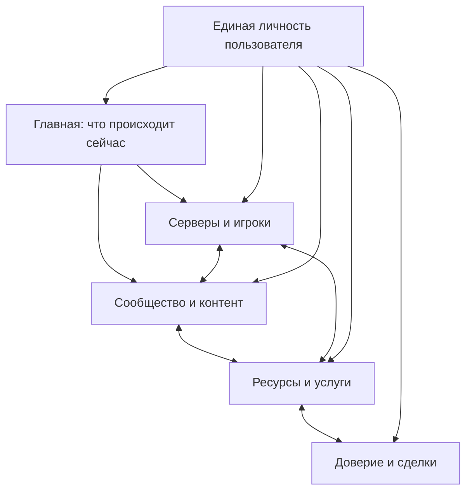

Warning: truncated output (original token count: 12706)
Total output lines: 589

# NEXUS MTA — Product Blueprint

> Каноническое видение законченного продукта и маршрут к релизу 1.0  
> Версия анализа: 17 сентября 2026  
> Рабочая ветка проекта: `dev`  
> Основной домен: `nexus-mta.com`; резервный вариант: `nexus-mta.pro`

## 1. Коротко: что мы строим

**NEXUS MTA — это единая игровая экосистема вокруг Multi Theft Auto: San Andreas, в которой игрок узнаёт, что происходит в MTA прямо сейчас, выбирает сервер, общается, следит за обновлениями, находит контент и безопасно получает или покупает ресурсы.**

Это не просто маркетплейс, каталог серверов или форум. Ценность возникает из связей между ними:

Главная продуктовая идея старых документов верна: пользователь должен возвращаться не только ради покупки, а ради вопроса **«Что нового происходит в MTA?»**. Главный пользователь — игрок. Серверы, создатели, продавцы и администрация образуют экосистему вокруг его опыта.

## 2. Что считается правдой

Источники противоречат друг другу, поэтому для дальнейшей разработки нужен строгий порядок приоритетов.

| Приоритет | Источник | Как используется |
|---:|---|---|
| 1 | Явные решения владельца проекта в текущем чате | Переопределяют любую старую документацию и код |
| 2 | Этот Blueprint после подтверждения | Определяет конечный продукт и границы релиза |
| 3 | Фактический код и воспроизводимые проверки `mta-nexus-site/dev` | Показывают, что существует сейчас, но не определяют желаемый продукт |
| 4 | `VISION`, `PRODUCT-MODEL`, `PRODUCT-ARCHITECTURE`, `PRODUCT-SURFACE-MAP`, `DAILY-EXPERIENCE` старого проекта | Сохраняют сильную продуктовую идею и модель связей |
| 5 | Старые планы, отчёты «выполнено», идеи и roadmap | Историческая информация и кандидаты, но не доказательство готовности |

Страница, таблица или API-маршрут не означают, что функция закончена. Функция готова только когда существует полноценный пользовательский путь, реальные данные, права доступа, обработка ошибок, модерация при необходимости и автоматическая проверка критических правил.

Процент готовности также нельзя вычислять по количеству файлов или закрытых планов. Указанные владельцем **примерно 30%** — полезная оценка масштаба, а не инженерная метрика.

## 3. Уже принятые решения

| Тема | Решение |
|---|---|
| Ветка | Вся разработка ведётся в `dev`; `main` не затрагивается до отдельного решения |
| Запуск | Локальная, тестовая и производственная эксплуатация — только через Docker |
| Размещение | Один VDS в пределах примерно $20–30 в месяц на начальном этапе |
| Резервные копии | Делает VDS-провайдер; перед релизом обязательно проверить восстановление, не создавая параллельную инфраструктуру без необходимости |
| Основной пользователь | Игрок MTA |
| География | Архитектура сразу международная; первый интерфейс как минимум RU/EN |
| Серверные данные | Официальный master-list MTA и публичные MTA-источники; опрос выполняет сама платформа |
| Код на MTA-серверах | Никаких обязательных агентов, Lua-ресурсов, `config.lua`, heartbeat-модулей или установок NEXUS на игровые серверы |
| Коммерция сейчас | Реальные платежи пока не подключаются |
| Коммерция в конечном продукте | Внешние платёжные/выплатные провайдеры, возможная криптооплата и внутренний учёт баланса остаются частью цели |
| Правовой статус | Владелец планирует работать как самозанятый; совместимость выбранных провайдеров и модели выплат должна быть подтверждена до запуска денег |
| Техническая форма | Модульный монолит, а не микросервисы |

## 4. Определение релиза 1.0

Релиз 1.0 — это не «все идеи, когда-либо записанные в старом проекте». Это законченная, связная платформа, где основные роли проходят свои сценарии от начала до конца.

### 4.1 Гость и игрок

Игрок без регистрации может:

- увидеть реальное суммарное число игроков и публичных серверов MTA;
- искать, сортировать и фильтровать серверы;
- открыть богатую страницу сервера с текущим состоянием, историей наблюдений, описанием, медиа, ссылками, новостями, обсуждениями и отзывами;
- открыть статьи, новости, руководства, публичный форум и каталог ресурсов;
- перейти в MTA через понятное действие подключения;
- видеть источник и свежесть показанных данных.

После регистрации игрок получает:

- единый профиль и настройки приватности;
- подписки на серверы, создателей, ресурсы и обсуждения;
- персональный экран «Мой MTA» с изменениями после последнего визита;
- уведомления с понятной причиной и ссылкой на действие;
- сохранённые объекты, историю полученных ресурсов, покупок и транзакций;
- возможность участвовать в обсуждениях, оставлять допустимые отзывы и отправлять жалобы.

### 4.2 Владелец сервера

Владелец может заявить права на уже существующий публичный сервер, подтвердить управление допустимым внешним способом и создать расширенную страницу.

Он управляет:

- названием и редакционным описанием;
- логотипом, обложкой и галереей;
- сайтом, Discord и другими официальными ссылками;
- новостями, обновлениями и changelog;
- связанным сообществом и его модераторами;
- публичностью команды, технической информации и используемых ресурсов;
- ответами на отзывы и обращениями в поддержку.

**Он не управляет live-онлайном вручную.** Текущие игроки, вместимость, имя из master-list и время наблюдения приходят из внешнего источника и визуально отделены от редакционных данных.

### 4.3 Создатель и продавец

Один аккаунт получает дополнительные возможности, а не превращается в отдельный «seller account». Создатель может:

- оформить публичную витрину;
- публиковать бесплатные и, после открытия коммерции, платные ресурсы;
- размещать скрипты, карты, модели, интерфейсы, плагины и другие поддержанные типы;
- управлять черновиком, модерацией, публикацией, версиями и архивированием;
- указывать реальные требования, зависимости и совместимость;
- загружать приватный артефакт и медиа;
- публиковать changelog и уведомлять владельцев ресурса об обновлении;
- видеть просмотры, получения, продажи, конверсию, возвраты и рейтинг;
- управлять доходом и заявками на выплату после запуска финансового контура.

Публикация должна проходить через независимое состояние модерации. Загрузка новой версии не может сама снять приостановку продукта или поставить фиктивную отметку «подписано».

### 4.4 Сообщество и контент

NEXUS содержит собственный тематический community-слой, а Discord остаётся внешним каналом. В 1.0 входят:

- категории, темы, ответы, цитаты, реакции и упоминания;
- подписки, поиск, жалобы, закрепление и закрытие тем;
- обсуждения, связанные с сервером, ресурсом, статьёй или новостью, когда связь действительно полезна;
- глобальные новости MTA, новости серверов и создателей;
- статьи, руководства, devlog и changelog;
- единый объект публикации, который может показываться в нескольких лентах без дублирования контента;
- модерирование, аудит и понятные состояния видимости.

Личная переписка общего назначения в 1.0 не нужна. Сообщения внутри будущей сделки допустимы как ограниченный контекст, а не как попытка построить ещё один мессенджер.

### 4.5 Маркет и доставка

Маркетплейс в 1.0 поддерживает:

- бесплатные и платные ресурсы;
- каталог, поиск, категории, фильтры, сортировку и пагинацию;
- галерею, описание, автора, требования, совместимость, версии, changelog и отзывы;
- бесплатное получение без создания нулевого платежа;
- заказ с неизменяемым снимком цены;
- entitlement — право пользователя получить конкретный продукт;
- приватную доставку артефакта только владельцу права;
- SHA-256, неизменяемые опубликованные сборки и журнал действий;
- уведомления об обновлениях и доступ к прежним допустимым версиям;
- возвраты и отзыв права только по формализованному процессу.

Лицензия NEXUS в этой архитектуре означает право на получение, обновления и использование по условиям автора. Без кода на игровом сервере платформа **не обещает runtime-DRM, привязку к железу, автоматическую установку или невозможность копирования**.

### 4.6 Финансы

Финансовый контур должен быть спроектирован заранее, но включается только после подтверждения юридической и провайдерской модели.

В релизной реализации:

- внешний провайдер принимает фиатный платёж;
- отдельный внешний провайдер может выставлять криптоинвойс;
- NEXUS не хранит приватные ключи и не становится криптокошельком;
- каждый webhook проверяется, идемпотентен и сверяется по сумме, валюте и назначению;
- `Payment`, `Order`, `Purchase`, `Entitlement`, `Refund`, `Payout` и `Ledger Entry` остаются разными сущностями;
- внутренний баланс вычисляется из неизменяемого журнала проводок, а не хранится числом, которое можно произвольно переписать;
- остатки ведутся отдельно по валютам; скрытая конвертация недопустима;
- покупатель видит операции, возвраты и доступные средства;
- продавец видит pending/available balance, комиссии, возвраты и выплаты;
- оператор может выполнить сверку с провайдером и расследовать расхождение.

Цель внутреннего баланса — уменьшить число внешних операций и корректно учитывать доход/возвраты. Но возможность пополнения, хранения и вывода средств может менять правовой статус продукта. Поэтому она является **обязательной точкой внешнего подтверждения**, а не функцией, которую безопасно «просто включить» кодом.

### 4.7 Доверие, модерация и поддержка

Вместо одного магического рейтинга используются объяснимые факты:

- «владелец сервера подтверждён»;
- «покупка ресурса подтверждена»;
- «создатель прошёл проверку»;
- число завершённых продаж и доля возвратов, если выборка достаточна;
- история публикаций и обновлений;
- подтверждённые решения модерации.

`Verified` всегда говорит, **что именно проверено**, но не означает «этому человеку гарантированно можно доверять».

Жалобы и санкции проходят через очередь модерации, доказательства, решение и апелляцию. Публичный blacklist не может быть доской непроверенных обвинений. Администратору нужны реальные рабочие экраны для пользователей, серверов, ресурсов, контента, жалоб, финансовых расхождений и аудита — не только счётчики.

## 5. Серверная платформа без серверного агента

Это главное изменение относительно старой архитектуры.

### 5.1 Источники данных

Официальный клиент MTA использует `https://master.multitheftauto.com/ase/mta/`. Его протокол предоставляет флаги для количества игроков, лимита, имени сервера, режима, карты, версии, пароля, HTTP-порта и других публичных полей. Публичная страница MTA также показывает текущие суммы и список серверов.

NEXUS должен:

1. получать master-list на стороне платформы;
2. строго проверять формат и полноту ответа;
3. сохранять время получения и не выдавать устаревший снимок за live;
4. периодически записывать ограниченные агрегированные наблюдения для графиков;
5. показывать `unknown`, если источник недоступен, вместо ложного `offline` или нулевого онлайна;
6. не хранить список игроков дольше и шире, чем реально нужно продукту;
7. ссылаться на источник данных в интерфейсе.

### 5.2 Две сущности, а не одна

Нужно разделить:

- **Observed Server** — автоматически обнаруженная запись из MTA: endpoint, live-поля, свежесть и история наблюдений;
- **Claimed Server Profile** — управляемая владельцем страница: брендинг, описание, ссылки, новости, сообщество и privacy-настройки.

Они связываются после подтверждения владения. Исчезновение сервера из очередного снимка не удаляет страницу и не означает автоматически «закрыт навсегда».

### 5.3 Подтверждение владения

Без агента допустим набор альтернатив:

- временное изменение публичного поля сервера, которое уже видно через MTA;
- DNS TXT для домена, указанного как официальный;
- подтверждение через контролируемый официальный сайт;
- связь с владельцем официального Discord/сообщества;
- ручная проверка модератором с доказательствами.

Конкретный автоматический метод выбирается только после проверки доступных публичных полей MTA. До этого ручное подтверждение лучше фиктивной автоматизации.

### 5.4 Отзывы о серверах

Без серверной интеграции NEXUS не способен доказать, что пользователь действительно играл. Нажатие «Подключиться» тоже не является таким доказательством.

Поэтому в 1.0:

- отзыв привязан к подтверждённому аккаунту;
- действуют лимиты, антиспам, жалобы и модерация;
- может отображаться факт перехода через NEXUS, но не бейдж `Verified Player`;
- формулировка `Verified interaction` запрещена, пока нет достоверного внешнего доказательства.

## 6. Основные пользовательские поверхности

| Раздел | Что находится в центре | Главное действие |
|---|---|---|
| Home | жизнь экосистемы прямо сейчас | найти интересное продолжение |
| Explore/Search | сервер, ресурс, автор, статья, обсуждение | найти и отфильтровать |
| Servers | официальный публичный каталог MTA | выбрать и подключиться |
| Server page | live-наблюдение + профиль сообщества | играть, подписаться, читать, обсуждать |
| Community | тематические обсуждения MTA | читать, отвечать, следить |
| Content/News | знания и обновления | прочитать и перейти к связанной сущности |
| Market | ресурсы и позже услуги | получить или купить |
| Resource page | конкретный продукт и доверие к нему | оценить, получить, купить, обновить |
| Creator page | публичная идентичность создателя | изучить работы и подписаться |
| My MTA | личный контекст пользователя | продолжить незавершённое и увидеть новое |
| Creator Studio | публикация и управление продуктами | выпустить и сопровождать ресурс |
| Finance | операции, баланс, возвраты, выплаты | понять состояние денег и выполнить допустимое действие |
| Trust/Support | подтверждения, жалобы, решения | безопасно разрешить проблему |
| Admin | эксплуатация всей платформы | модерировать, сверять и расследовать |

Навигация контекстная. Игроку не показ…706 tokens truncated…ватном Docker volume и выдаются только через авторизованный endpoint. При росте объёма они переезжают в S3-совместимое хранилище через уже предусмотренный интерфейс.

Отдельный worker допустим как ещё один контейнер того же кода для периодических задач, но это не отдельный микросервис. Redis появляется только при нескольких инстансах или доказанной нагрузке.

### 8.2 Правила Docker-only

- Единственная поддерживаемая инструкция запуска начинается с `docker compose`.
- Миграции выполняются контролируемо перед запуском приложения.
- Версии Node, pnpm и PostgreSQL совпадают в документации, CI и образах.
- В образ не копируются `.env`, Git-история, локальные загрузки и ненужные dev-файлы.
- Контейнер работает не от root, имеет healthcheck и предсказуемое завершение.
- CI отдельно собирает production image и запускает smoke-test Compose.
- «Compose-файл существует» не равно «production Docker проверен».

## 9. Честный срез текущего `mta-nexus-site/dev`

Проверен commit `3bde73af7daa524efa7e65c0e86ea360cf205fa4`. Последний CI для этого commit успешен, но CI выполняет миграции, typecheck, тесты и `next build`; Docker image и production Compose он не проверяет.

### Что уже является полезным фундаментом

- monorepo и модульный монолит;
- PostgreSQL/Drizzle и миграции;
- базовая локальная аутентификация и сессии;
- серверные политики доступа;
- профили, организации, каталог ресурсов, builds, entitlements;
- заказы, платежные сущности и ledger foundation;
- статьи, follows, уведомления, отзывы, жалобы, audit и verification requests;
- бесплатное получение и защищённая загрузка;
- получение официального MTA master-list;
- Docker/Compose-заготовка и успешный CI.

### Что документация сейчас преувеличивает или описывает неверно

| Заявление | Фактическое состояние |
|---|---|
| «Better Auth» | В коде собственные password/session flows, Better Auth в зависимостях отсутствует |
| Node 24 / PostgreSQL 18 | Docker и CI используют Node 22 и PostgreSQL 16 |
| Zod 4 | Web-приложение использует Zod 3.24 |
| «серверный агент удалён» | Активные API, сервисы и UI используют официальный MTA master-list; legacy installations/heartbeats сохранены только для безопасной миграции данных |
| «полноценный server ecosystem» | Есть каталог и страница, но нет законченных server news/community/claim flows без агента |
| «build подписан» | `isSigned: true` ставится при обычной загрузке без криптографической подписи |
| «публикация проходит модерацию» | Загрузка build сразу создаёт `published` и переводит продукт в `published` |
| «production-ready Docker» | Конфигурация существует, но production image/Compose не входят в CI gate |
| «полная финансовая система» | Платные продукты намеренно отключены; внешних провайдеров, webhook settlement, refunds и payouts пока нет |

### Критический долг до новых крупных функций

1. Удалить runtime-модель server agent/installation/heartbeat из активной схемы API, сервисов, UI и тестов; исторические таблицы не использовать для live-статуса и удалить отдельной миграцией после проверки сохранности данных.
2. Разделить обнаруженный сервер и управляемый профиль сервера.
3. Проверить binary parser master-list на реальных fixtures, строгий EOF/count, корректность IP/port и поведение при частичном ответе.
4. Не показывать `0 игроков`, когда каталог недоступен; использовать `unknown` и свежесть снимка.
5. Исправить публикацию ресурсов: `draft → pending_review → published`; никакой самопубликации или фиктивной подписи.
6. Проверять magic bytes/структуру архива, лимиты распаковки, traversal, запрещённые файлы и результат сканирования; расширение файла недостаточно.
7. Закрыть обходы модерации при restore/release и проверять, что административное действие действительно изменило существующую запись.
8. Сверить каждое заявление документов с кодом; `PLAN completed` заменить на проверяемые capabilities и known limitations.
9. Добавить Docker build + Compose smoke в CI, `.dockerignore`, безопасный build context и проверку миграций на пустой БД.
10. Построить настоящие community/content/server-owner вертикальные сценарии вместо расширения числа несвязанных таблиц.

## 10. Маршрут разработки

Это последовательность по зависимостям, а не обещание календарных сроков. Каждая волна заканчивается работающим вертикальным сценарием.

### Волна 0 — единая правда и очистка фундамента

Результат: код и документация больше не спорят с решениями владельца.

- принять этот Blueprint как продуктовый источник истины;
- удалить agent/heartbeat направление;
- зафиксировать канонические версии стека;
- исправить состояния публикации и ложные trust-флаги;
- добавить Docker smoke и security checks;
- сформировать карту существующих функций: `working / partial / schema-only / absent`.

**Гейт:** чистый Docker-запуск поднимает проект с пустой БД, все тесты проходят, а UI нигде не обещает несуществующую возможность.

### Волна 1 — настоящее ядро игрока

- RU/EN localization foundation;
- гостевой Home «Сейчас в MTA»;
- полный каталог официальных серверов, поиск, фильтры, пагинация, fresh/stale/unknown;
- профили и privacy settings;
- follows, saved и actionable notifications;
- единый поиск по уже существующим типам.

**Гейт:** новый гость без регистрации находит сервер по реальным данным и понимает, куда идти дальше; зарегистрированный игрок подписывается и получает полезное обновление.

### Волна 2 — сервер как центр сообщества

- Observed Server + Claimed Profile;
- claim/verification без кода на сервере;
- богатая страница, медиа, ссылки и connect;
- история наблюдений 24h/7d/30d с честной семантикой;
- server news, updates, followers;
- privacy и явный opt-in для технических связей;
- отзывы без ложного `verified played`.

**Гейт:** реальный владелец заявляет публичный сервер, оформляет его страницу, публикует новость, а игрок находит сервер, подписывается и возвращается по уведомлению.

### Волна 3 — community и контент

- форум, темы, ответы, реакции, mentions и subscriptions;
- связанные обсуждения;
- статьи, guides, global/entity news и changelog;
- отчёты, модерация, аудит и appeals;
- живая лента из ограниченного набора реальных публичных событий.

**Гейт:** публикация существует в одном экземпляре, появляется в нужных контекстах, обсуждается, модерируется и приводит пользователя к связанной сущности.

### Волна 4 — бесплатная creator platform

- creator onboarding и storefront;
- draft/moderation/publication lifecycle;
- безопасные uploads и версии;
- совместимость и зависимости;
- бесплатное получение, entitlement и download;
- обновления, отзывы подтверждённых получателей и базовая аналитика.

**Гейт:** новый создатель публикует настоящий архив после модерации; игрок получает и скачивает его; чужой, черновой и suspended build недоступны.

### Волна 5 — закрытая бета без денег

- реальные игроки, серверы и создатели;
- onboarding, feedback и support process;
- abuse controls, rate limits и performance review;
- production Docker drill;
- восстановление из VDS backup;
- наблюдаемость и журнал инцидентов.

**Гейт:** несколько недель реальные пользователи проходят ключевые сценарии без ручного исправления данных разработчиком.

### Волна 6 — финансовая готовность

- решение по юрисдикции, статусу самозанятого и договорам;
- подтверждение провайдеров для стран, типа цифрового товара, продавцов и выплат;
- правила возвратов, споров, KYC и налоговых документов;
- provider-neutral contracts;
- idempotency, webhook verification, reconciliation и concurrency tests;
- multi-currency ledger и операторские экраны.

**Гейт:** внешний review подтверждает допустимость модели, а sandbox и failure tests доказывают, что повторный/поздний webhook не создаёт деньги или entitlement дважды.

### Волна 7 — платный маркет и баланс

- платный checkout;
- фиатный провайдер;
- опциональный crypto invoice provider;
- refunds/chargebacks;
- seller receivables, комиссии и controlled payouts;
- внутренний balance в разрешённой модели;
- финансовая история покупателя и продавца;
- сверка и аварийная остановка платежей.

**Гейт:** реальная тестовая покупка полностью сверяется от провайдера до ledger, entitlement, возврата и выплаты; оператор способен объяснить каждую проводку.

### Волна 8 — релиз 1.0

- security review критических маршрутов;
- browser E2E всех ролей;
- accessibility/mobile/performance;
- legal pages и рабочие каналы abuse/support;
- monitoring, incident procedures и rollback;
- production restore + deploy rehearsal;
- постепенное приглашение пользователей.

**Гейт:** выполнено определение готовности ниже. Только тогда `dev` становится кандидатом на перенос в `main` отдельным решением владельца.

## 11. Definition of Done для релиза

### Продукт

- каждый основной экран относится к известной роли и пользовательскому пути;
- нет пустых showcase-страниц и кнопок, имитирующих функцию;
- гость получает пользу до регистрации;
- Home отвечает на вопрос «что происходит сейчас» реальными данными;
- серверы, контент, сообщество и маркет связаны понятными переходами;
- интерфейс доступен на русском и английском и готов к добавлению языков;
- мобильная версия не является урезанной.

### Данные и безопасность

- приватные покупки, лицензии, сделки и технические данные не утекут через UI/API;
- все важные transitions транзакционны, идемпотентны и оставляют audit trail;
- файлы приватны, проверены и выдаются только после авторизации;
- публичные метрики вычисляются из реальных событий и показывают свежесть;
- роли/capabilities проверяются сервером;
- нет hardcoded secrets, production placeholder и silent-success при ошибке БД;
- критические flows покрыты unit, integration, concurrency и browser E2E тестами.

### Эксплуатация

- весь продукт воспроизводимо запускается через Docker;
- production image и Compose проверяются CI;
- deploy, migration, rollback и healthcheck отрепетированы;
- VDS backup реально восстановлен в отдельное окружение;
- журналирование не содержит секретов и персональных данных без причины;
- стоимость укладывается в бюджет до появления нагрузки, требующей осознанного расширения.

### Финансы

- правовая и провайдерская совместимость подтверждена;
- сумма и валюта определяются сервером;
- подписи webhook проверяются;
- повторные события безопасны;
- ledger сходится по каждой валюте;
- reconciliation, refund, dispute и payout имеют операторский процесс;
- платный entitlement невозможен без подтверждённого settlement или допустимой внутренней проводки.

## 12. Метрики, по которым виден успех

Главная метрика — **еженедельно активные участники MTA-экосистемы, совершившие полезное действие**, а не число регистраций.

Поддерживающие метрики:

- доля гостей, открывших сервер или контент после Home;
- переходы `server → connect`;
- подписки и возврат по уведомлению;
- активные claimed server profiles;
- созданные обсуждения и доля получивших ответ;
- опубликованные и обновляемые ресурсы;
- успешные бесплатные получения и загрузки;
- конверсия платного ресурса после запуска коммерции;
- возвраты, споры и время их разрешения;
- ошибки каталогов, загрузок, платежей и webhook;
- доля событий, для которых источник и состояние могут быть объяснены.

Vanity metrics вроде общего числа пользователей, просмотров или «магического trust score» не должны управлять развитием сами по себе.

## 13. Открытые решения, где действительно нужен владелец

До волн 0–5 разработка может двигаться без дополнительных бизнес-решений. Для финансовой части потребуются конкретные ответы:

1. Страна налоговой регистрации самозанятого и страны первого платного запуска.
2. Какие провайдеры реально заключают договор для цифрового marketplace и поддерживают выплаты третьим лицам.
3. Кто является продавцом перед покупателем: NEXUS или каждый создатель.
4. Может ли внутренний баланс пополняться и выводиться или это только учёт выручки/возвратных кредитов.
5. Кто несёт обязанность по возвратам, chargeback, KYC и чекам.
6. Нужны ли услуги и защищённые сделки в 1.0 или это версия после стабильного рынка ресурсов.

Это не повод останавливать продукт сейчас. Финансовая архитектура может иметь правильные границы заранее, а провайдеры подключаются после ответов.

## 14. Итоговая позиция

Лучший NEXUS MTA — не копия старого `mta-market-platform` и не сокращённый каталог бесплатных файлов. Старый проект даёт сильную продуктовую модель и много полезных инвариантов, но приносит слишком тяжёлые серверные интеграции, DRM, инфраструктуру и преждевременные коммерческие системы.

Текущий Nexus теперь использует официальный MTA master-list для live-данных, отделяет редакционные профили от наблюдений и явно показывает trust-состояния ресурсов; legacy agent-таблицы остаются неактивными до отдельной миграции.

Правильное направление:

> **сначала живая международная платформа игрока и серверных сообществ на публичных данных MTA; затем законченная creator platform; после реальной беты — юридически и технически корректная коммерция с внешними провайдерами и прозрачным ledger.**

Такой порядок сохраняет весь большой замысел, укладывается в ограниченный бюджет и не требует обещать пользователям то, чего система пока не умеет доказать.

## 15. Источники анализа

### Старое продуктовое видение

- [VISION.md](https://github.com/acc-holo-dev/mta-market-platform/blob/36471a09efaad8ba533917dd62d87069c6b4f9b5/documents/product/VISION.md)
- [PRODUCT-ARCHITECTURE.md](https://github.com/acc-holo-dev/mta-market-platform/blob/36471a09efaad8ba533917dd62d87069c6b4f9b5/documents/product/PRODUCT-ARCHITECTURE.md)
- [PRODUCT-MODEL.md](https://github.com/acc-holo-dev/mta-market-platform/blob/36471a09efaad8ba533917dd62d87069c6b4f9b5/documents/product/PRODUCT-MODEL.md)
- [PRODUCT-SURFACE-MAP.md](https://github.com/acc-holo-dev/mta-market-platform/blob/36471a09efaad8ba533917dd62d87069c6b4f9b5/documents/product/PRODUCT-SURFACE-MAP.md)
- [DAILY-EXPERIENCE.md](https://github.com/acc-holo-dev/mta-market-platform/blob/36471a09efaad8ba533917dd62d87069c6b4f9b5/documents/product/DAILY-EXPERIENCE.md)
- [Ideas](https://github.com/acc-holo-dev/mta-market-platform/tree/36471a09efaad8ba533917dd62d87069c6b4f9b5/documents/ideas)

### Текущий Nexus

- [Репозиторий `dev` на проверенном commit](https://github.com/acc-holo-dev/mta-nexus-site/tree/3bde73af7daa524efa7e65c0e86ea360cf205fa4)
- [Foundation audit](https://github.com/acc-holo-dev/mta-nexus-site/blob/3bde73af7daa524efa7e65c0e86ea360cf205fa4/docs/FOUNDATION-AUDIT.md)
- [Legacy migration map](https://github.com/acc-holo-dev/mta-nexus-site/blob/3bde73af7daa524efa7e65c0e86ea360cf205fa4/docs/LEGACY-MIGRATION-MAP.md)
- [Current schema](https://github.com/acc-holo-dev/mta-nexus-site/blob/3bde73af7daa524efa7e65c0e86ea360cf205fa4/packages/db/src/schema.ts)
- [Current product service](https://github.com/acc-holo-dev/mta-nexus-site/blob/3bde73af7daa524efa7e65c0e86ea360cf205fa4/apps/web/src/lib/services/product-service.ts)
- [Current server page](https://github.com/acc-holo-dev/mta-nexus-site/blob/3bde73af7daa524efa7e65c0e86ea360cf205fa4/apps/web/src/app/servers/%5Bslug%5D/page.tsx)
- [Production Compose](https://github.com/acc-holo-dev/mta-nexus-site/blob/3bde73af7daa524efa7e65c0e86ea360cf205fa4/compose.production.yaml)
- [CI](https://github.com/acc-holo-dev/mta-nexus-site/blob/3bde73af7daa524efa7e65c0e86ea360cf205fa4/.github/workflows/ci.yml)
- [Successful CI run for the inspected commit](https://github.com/acc-holo-dev/mta-nexus-site/actions/runs/35187930637)

### Официальные MTA-источники

- [MTA server browser contract](https://github.com/multitheftauto/mtasa-blue/blob/15185c5c8017179fa1cae7d93f034faa58636121/Client/core/ServerBrowser/CServerList.h)
- [Публичный список серверов MTA](https://community.multitheftauto.com/index.php?p=servers)

---

**Статус документа:** предложение на утверждение. После подтверждения его стоит перенести в `mta-nexus-site/docs/PRODUCT-BLUEPRINT.md`, связать с `README` и использовать как верхнеуровневый фильтр для следующих implementation plans.

## Build trust contract (closed beta)

- Every uploaded build is validated against its declared archive format before it is stored.
- ZIP, RAR, and 7z uploads must contain their expected magic bytes; Lua resources remain text uploads.
- A user upload is never marked as cryptographically signed by default. `isSigned` stays false until a separate trusted signing pipeline exists.
- The closed beta may publish free resources for delivery, but “published” and “signed” are intentionally separate states.
